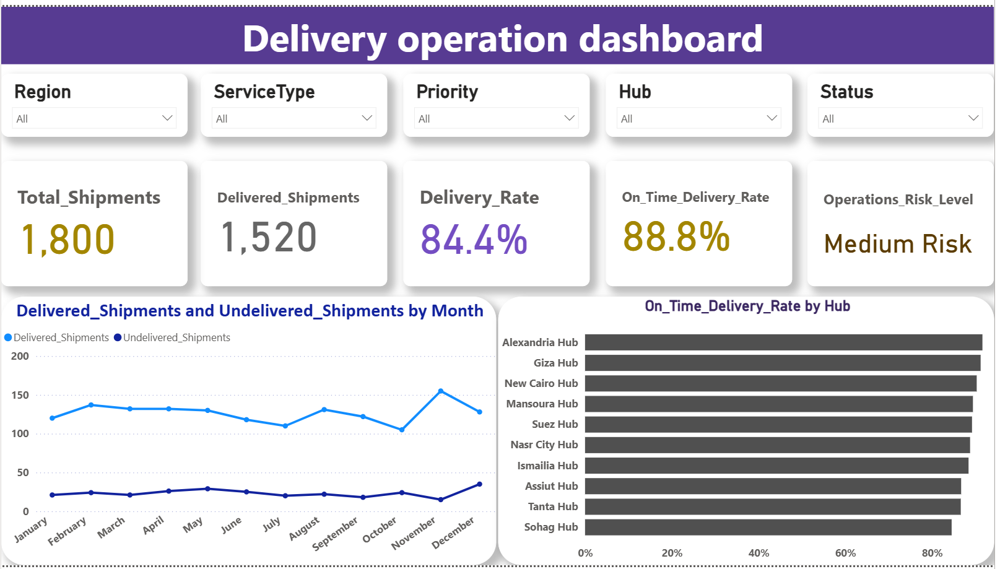
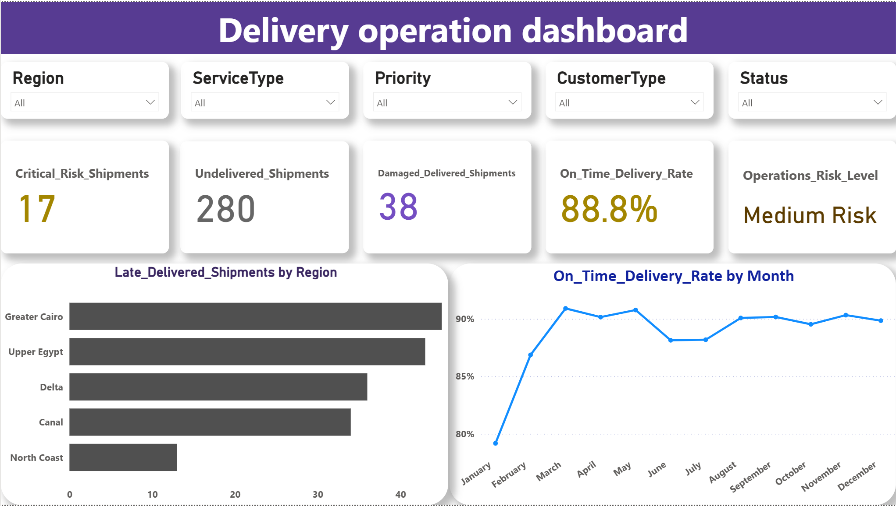
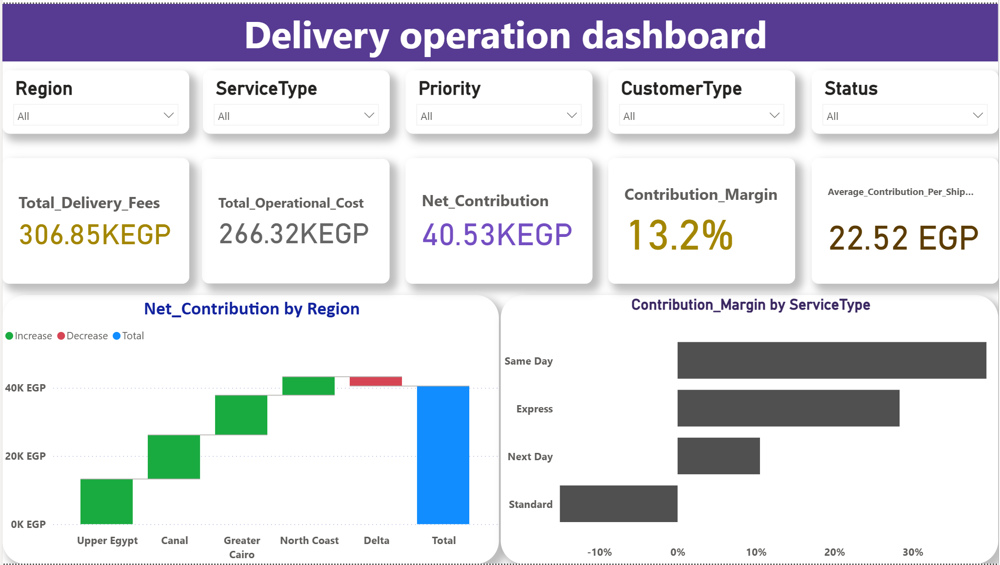
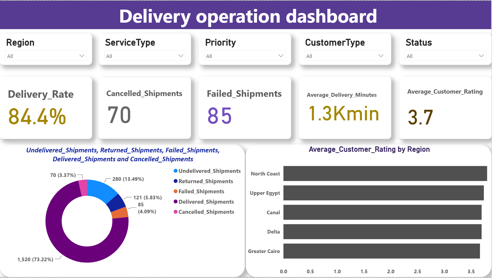

# Delivery Operations Dashboard (Power BI)

An interactive four-page Power BI dashboard that gives a delivery company a clear view of operations, risk, profitability, and service quality, with filters by Region, Service Type, Priority, Customer Type, and Status.

## The Problem
The company knew its revenue but could not tell whether each region and service type was actually profitable, how operating costs affected net profit, which service type had the highest margin, and where shipments were delayed or failing.

## The Solution
A multi-page dashboard covering operational performance, risk and delays, profitability, and service quality, built with DAX measures and interactive filters.

## Dashboard Pages
1. **Operations Overview:** total and delivered shipments, delivery rate, on-time delivery rate, operations risk level, delivered vs. undelivered shipments by month, and on-time delivery rate by hub
2. **Risk and Delays:** critical-risk shipments, undelivered shipments, damaged delivered shipments, late shipments by region, and monthly on-time delivery trend
3. **Profitability:** total delivery fees, operational cost, net contribution, contribution margin, average contribution per shipment, a waterfall chart of net contribution by region, and contribution margin by service type
4. **Service Quality:** delivery rate, cancelled and failed shipments, average delivery time, average customer rating, shipment status breakdown, and customer rating by region

## Screenshots

### Operations Overview

### Risk and Delays

### Profitability

### Service Quality

## Key Findings
- 1,800 shipments, 1,520 delivered: delivery rate 84.4%, on-time delivery rate 88.8%, operations risk level: Medium
- Shipment outcomes: 280 undelivered, 121 returned, 85 failed, 70 cancelled, and 38 delivered shipments were damaged
- On-time delivery was weakest in January and improved clearly by March
- Greater Cairo has the most late shipments, followed by Upper Egypt; North Coast has the fewest
- Total delivery fees: 306.85K EGP | Operational cost: 266.32K EGP | Net contribution: 40.53K EGP
- Contribution margin: 13.2% | Average contribution per shipment: 22.52 EGP
- Delta is the only region that reduced net contribution
- Same Day has the highest margin, followed by Express and Next Day; Standard has a negative margin (it loses money)
- Average customer rating: 3.7

## Recommendations
- Review the pricing of the Standard service or reduce its operating cost
- Focus on Same Day and Express services
- Investigate the losses in the Delta region
- Address the causes of delays in Greater Cairo and Upper Egypt
- Monitor damaged and critical-risk shipments

## How It Was Built
- DAX measures: Net Contribution = Fees - Cost, Contribution Margin = Net Contribution / Fees
- Waterfall chart to show each region's effect on net contribution
- Service-level analysis to identify loss-making services
- Multi-page report with interactive Slicers

## Tools
Power BI: DAX, Waterfall Chart, Slicers, Dashboard design

## Repository Contents
- Delivery_Operations_Dashboard.pbix: the Power BI dashboard file
- screenshots/: previews of the four dashboard pages
